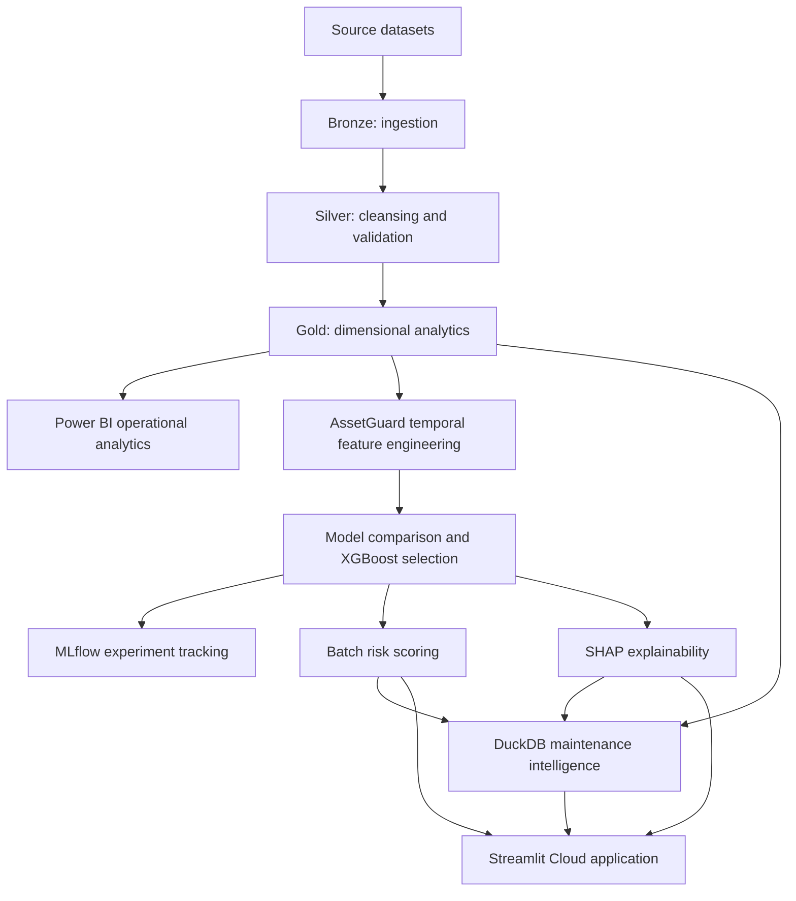
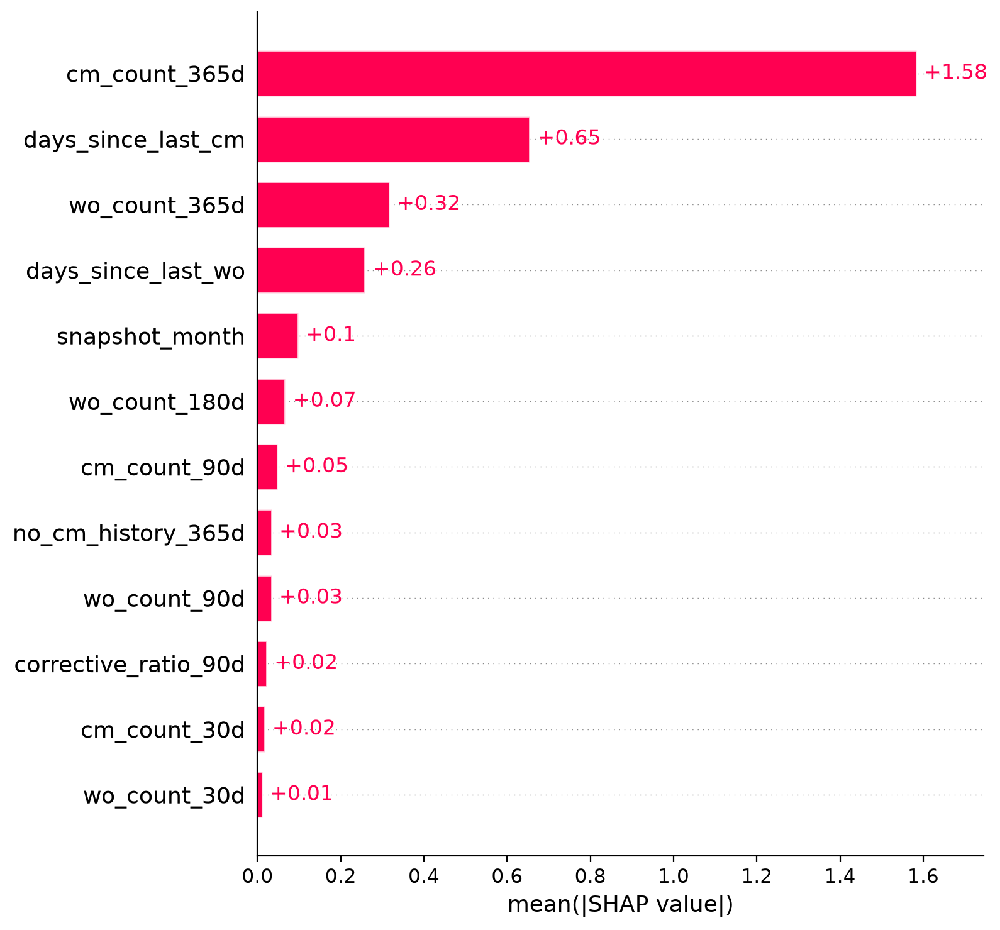

# AssetFusion360
### Enterprise Asset Management, Predictive Maintenance & Operational Analytics

[](https://assetfusion360.streamlit.app/)
[](https://www.python.org/)
[](https://kedro.org/)
[](https://xgboost.readthedocs.io/)

**[Launch the live AssetFusion360 application](https://assetfusion360.streamlit.app/)**

Developed by **Tripti Singh** | Rutgers Business School | Master of Information Technology & Analytics | Capstone 2026

## Overview

AssetFusion360 is an end-to-end enterprise asset analytics platform that brings together data engineering, business intelligence, machine learning, explainable AI and maintenance decision support. Its AssetGuard module prioritizes assets for proactive review by forecasting the likelihood of new corrective maintenance work orders within the next 30 days.

The platform addresses three operational questions: Which assets need attention? What historical maintenance patterns drive their risk scores? Which past work orders can inform maintenance decisions?

## Project highlights

| Indicator | Result |
|---|---:|
| Historical work orders in Gold layer | 2,231,535 |
| Asset-month modeling observations | 2,733,245 |
| Engineered model features | 12 |
| Algorithms evaluated | 4 |
| Selected model | XGBoost |
| Held-out test ROC-AUC | 0.9326 |
| Assets scored in batch forecast | 14,983 |
| High-risk assets identified | 2,415 |
| Interactive application pages | 7 |

## Architecture



The engineering workflow uses a medallion architecture, Kedro project structure, PySpark/Databricks notebooks and Parquet datasets. The hosted application consumes prepared analytical artifacts and uses DuckDB for historical retrieval; it does not require a live Databricks cluster for each user request.

## Data engineering and analytics

- **Bronze:** source ingestion and preservation of raw records.
- **Silver:** schema standardization, cleaning, validation and relationship checks.
- **Gold:** analytical asset, work order, labor and transaction datasets.
- **Business intelligence:** Power BI reporting for maintenance operations, labor utilization and transaction analytics.
- **AssetGuard:** historical feature generation, model evaluation, risk scoring and interpretation.

The project incorporates NYC Parks asset management and maintenance records, with additional NYC 311 and AI4I data engineering work in the broader project. The reported AssetGuard baseline uses historical work-order activity, not AI4I physical failure labels.

## Machine learning methodology

The binary target indicates whether an eligible asset has a new corrective maintenance work order created in the next 30 days. Monthly snapshots use up to 365 days of prior history, including work-order frequency, corrective maintenance frequency, recency and seasonality. Assets must have maintenance history in the preceding year to be eligible.

### Chronological data split

| Dataset | Snapshot period | Observations | Positive rate |
|---|---|---:|---:|
| Training | 2015–2023 | 2,177,708 | 9.06% |
| Validation | 2024 | 202,185 | 11.37% |
| Test | Jan 2025–Sep 2026 | 353,352 | 11.10% |

Temporal feature checks reported zero duplicate groups, invalid historical features and incomplete target windows. The model uses work-order creation timestamps as an availability proxy; historical changes to mutable attributes remain a limitation.

### Validation model comparison

| Algorithm | ROC-AUC | Average precision | F1 |
|---|---:|---:|---:|
| **XGBoost** | 0.93704 | **0.67441** | 0.62892 |
| LightGBM | 0.93704 | 0.67415 | 0.62853 |
| Random Forest | 0.93551 | 0.66951 | 0.62664 |
| Logistic Regression | 0.93343 | 0.66058 | 0.62568 |

XGBoost was selected using validation average precision, with a small advantage over LightGBM. Random Forest was trained on a stratified 300,000-record sample. The decision threshold (0.80673) was selected on validation data.

### Independent test results

| Metric | Value |
|---|---:|
| Accuracy | 90.83% |
| Balanced accuracy | 81.30% |
| ROC-AUC | 0.93263 |
| Average precision | 0.67599 |
| Precision | 57.19% |
| Recall | 69.06% |
| F1 | 0.62564 |

| Actual / predicted | Negative | Positive |
|---|---:|---:|
| Negative | 293,845 | 20,279 |
| Positive | 12,139 | 27,089 |

[Model comparison](data/07_data_quality_reports/assetguard_baseline/model_comparison.csv) · [Test metrics](data/07_data_quality_reports/assetguard_baseline/test_metrics.json) · [Feature validation](data/05_predictive_maintenance_features/assetguard_feature_validation.json)

## Explainable AI

SHAP provides global feature importance and asset-specific explanations. The leading global drivers are annual corrective work-order count, days since last corrective maintenance and annual work-order frequency. SHAP values explain contributions to the raw model margin rather than causal effects or percentage-point changes in probability.



## Asset risk forecast

Source cutoff: **October 24, 2026**. Forecast window: **October 25–November 23, 2026**, inclusive.

| Risk category | Assets |
|---|---:|
| High | 2,415 |
| Medium | 2,077 |
| Moderate | 2,358 |
| Low | 8,133 |
| **Total** | **14,983** |

The scores are uncalibrated model outputs. High risk uses the validated decision threshold; the remaining categories use provisional business thresholds. This is a historical batch forecast, not a continuously refreshed operational feed.

[Forecast summary](data/07_asset_risk_predictions/latest_batch/prediction_summary.json)

## Interactive application

**[Open AssetFusion360 on Streamlit Cloud](https://assetfusion360.streamlit.app/)**

| Page | Capability |
|---|---|
| Executive Overview | Portfolio KPIs, risk distribution and maintenance prioritization |
| Asset Risk Explorer | Searchable risk register, filters and CSV exports |
| Asset 360 | Individual risk scores, SHAP drivers, maintenance history and recommendations |
| Explainable AI | Model comparison, test metrics, confusion matrix and SHAP analysis |
| Maintenance Case Search | Keyword-based retrieval of historical work orders |
| AI Assistant | Tool-based natural-language question routing and evidence retrieval |
| Model Governance | Model metadata, temporal splits, experiment tracking and limitations |

Example assistant queries:

- Show portfolio summary
- Show top 10 high risk assets
- Why is asset 14167 high risk?
- Show maintenance history for asset 14167
- Find similar workorders for leaking pipe

The current assistant uses deterministic intent routing and DuckDB retrieval. Hosted Llama integration and semantic vector search are planned extensions, not implemented capabilities of this release.

## Technology stack

| Layer | Technologies |
|---|---|
| Data engineering | Python, PySpark, Kedro, Azure Databricks notebooks, SQL |
| Analytical storage | Parquet, DuckDB |
| Machine learning | scikit-learn, XGBoost, LightGBM |
| Explainability and experiments | SHAP, MLflow |
| Visualization | Power BI, Plotly, Streamlit |
| Deployment and version control | Streamlit Community Cloud, GitHub |

## Repository structure

```text
AssetFusion360/
├── app/                         # Streamlit application, assets and dependencies
├── .streamlit/                  # Application theme and hosting configuration
├── conf/                        # Kedro configuration
├── data/
│   ├── 04_gold_analytics/
│   ├── 05_predictive_maintenance_features/
│   ├── 06_trained_ml_models/
│   ├── 07_asset_risk_predictions/
│   └── 07_data_quality_reports/
├── docs/                        # Project documentation
├── notebooks/                   # Engineering notebooks
├── reports/                     # Analytical reports
├── PowerBI_MS_Fabric/            # BI branding/supporting files
├── src/assetfusion360/
│   └── pipelines/assetguard/
│       ├── feature_engineering.py
│       ├── model_training.py
│       ├── model_explainability.py
│       ├── risk_prediction.py
│       └── maintenance_agent.py
├── tests/
├── pyproject.toml
└── requirements.txt
```

## Run the application locally

Python 3.12 is recommended. From a terminal:

```bash
git clone https://github.com/TriptiSingh-Developer/AssetFusion360.git
cd AssetFusion360
python -m venv .venv
```

Activate the environment on Windows PowerShell:

```powershell
.\.venv\Scripts\Activate.ps1
```

Or on macOS/Linux:

```bash
source .venv/bin/activate
```

Install application dependencies and launch:

```bash
python -m pip install -r app/requirements.txt
python -m streamlit run app/assetguard_app.py
```

Open http://localhost:8501 (or the URL printed in the terminal). The app requires the prepared Parquet, CSV and JSON artifacts under `data/`. Retraining is not required to browse the precomputed results.

For engineering and training work, install the root project dependencies and package, and ensure the additional ML libraries in `app/requirements.txt`, MLflow, and required source/Gold data are available. The standalone AssetGuard scripts are under `src/assetfusion360/pipelines/assetguard/`. The application deployment and full pipeline reproduction have different dependency and data requirements.

## Governance and limitations

- The model predicts corrective maintenance demand, not physical equipment failure.
- Scores are uncalibrated and should not be treated as failure probabilities.
- Eligibility is restricted to assets with recent maintenance history.
- Mutable historical fields may introduce temporal availability limitations.
- The public application serves a historical research batch; data refresh, monitoring, access controls and production validation remain future work.
- Maintenance recommendations require human review; the system does not automatically execute work orders.
- The full Power BI binary is not included in ordinary Git storage due to its size.

## Roadmap

- Hosted Llama-powered assistant and semantic maintenance case retrieval.
- AssetGuard pipeline registration, expanded automated tests and CI validation.
- Operational data refresh, model monitoring and calibrated risk scoring.
- Further BI KPI validation and cloud integration.

## Author

**Tripti Singh**  
Master of Information Technology & Analytics, Rutgers Business School  
[GitHub](https://github.com/TriptiSingh-Developer) · [Portfolio](https://triptisingh-developer.github.io/) · [Live Application](https://assetfusion360.streamlit.app/)
