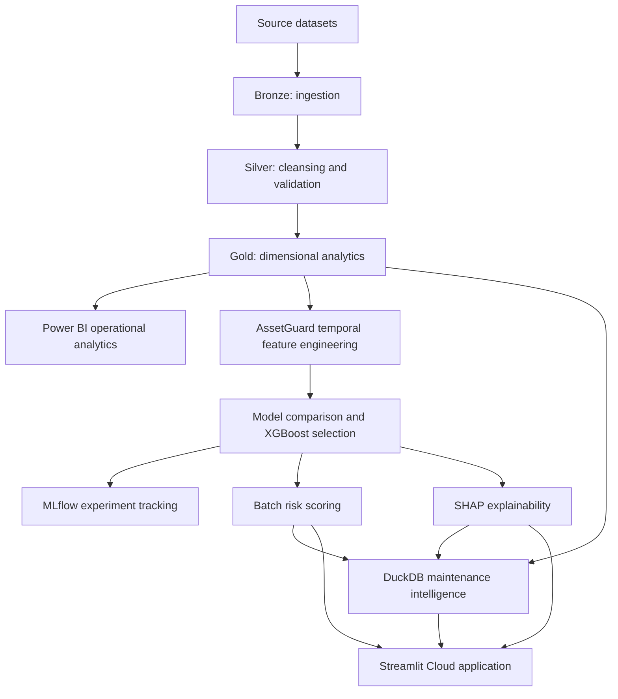
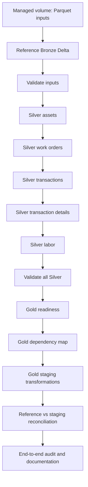
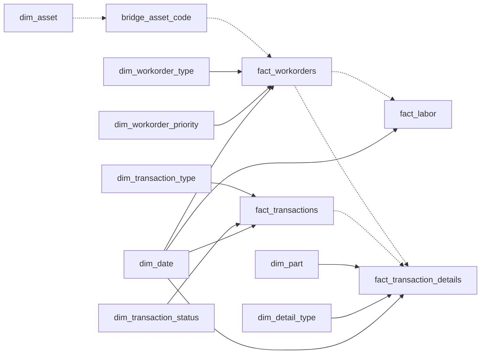

# AssetFusion360
### Enterprise Asset Management, Predictive Maintenance & Operational Analytics

[](https://assetfusion360.streamlit.app/)
[](https://www.python.org/)
[](https://kedro.org/)
[](https://xgboost.readthedocs.io/)

**[Launch the live AssetFusion360 application](https://assetfusion360.streamlit.app/)**

Developed by **Tripti Singh** | Rutgers Business School | Master of Information Technology & Analytics | Capstone 2026

## Overview

AssetFusion360 is an end-to-end enterprise asset analytics platform that brings together data engineering, business intelligence, machine learning, explainable AI and maintenance decision support. Its AssetGuard module prioritizes assets for proactive review by forecasting the likelihood of new corrective maintenance work orders within the next 30 days.

The platform addresses three operational questions: Which assets need attention? What historical maintenance patterns drive their risk scores? Which past work orders can inform maintenance decisions?

## Project highlights

| Indicator | Result |
|---|---:|
| Profiled source records | 9,705,756 |
| Gold analytical tables | 17 |
| Combined Gold table rows | 8,855,330 |
| Historical work orders in Gold layer | 2,231,535 |
| Asset-month modeling observations | 2,733,245 |
| Engineered model features | 12 |
| Algorithms evaluated | 4 |
| Selected model | XGBoost |
| Held-out test ROC-AUC | 0.9326 |
| Assets scored in batch forecast | 14,983 |
| High-risk assets identified | 2,415 |
| Interactive application pages | 7 |

## Architecture



The engineering workflow uses a medallion architecture, Kedro project structure, PySpark/Databricks notebooks and Parquet datasets. The hosted application consumes prepared analytical artifacts and uses DuckDB for historical retrieval; it does not require a live Databricks cluster for each user request.

## Data engineering and analytics

- **Bronze:** source ingestion and preservation of raw records.
- **Silver:** schema standardization, cleaning, validation and relationship checks.
- **Gold:** analytical asset, work order, labor and transaction datasets.
- **Business intelligence:** Power BI reporting for maintenance operations, labor utilization and transaction analytics.
- **AssetGuard:** historical feature generation, model evaluation, risk scoring and interpretation.

The project incorporates NYC Parks asset management and maintenance records, with additional NYC 311 and AI4I data engineering work in the broader project. The reported AssetGuard baseline uses historical work-order activity, not AI4I physical failure labels.

## End-to-end implementation: source to decision support

### 1. Source acquisition and profiling

The consolidated source inventory reconciled **9,705,756 records across eight datasets** (records across different grains, not unique assets).

| Source | Records | Role |
|---|---:|---|
| NYC Parks AMPS Assets | 148,522 | Asset inventory |
| AMPS Work Orders | 2,231,535 | Maintenance events |
| AMPS Labor | 3,230,423 | Labor bookings and costs |
| AMPS Transactions | 755,122 | Transaction headers |
| AMPS Transaction Details | 2,301,927 | Material and transaction lines |
| NYC 311 Service Requests | 875,134 | Service demand context |
| Parks Inspections | 153,093 | Inspection and condition context |
| AI4I Predictive Maintenance | 10,000 | Separate synthetic ML benchmark dataset |

Source profiling covers schema consistency, missingness, identifiers, row reconciliation and cross-dataset reference integrity. NYC 311 and inspections are supplementary domains; their cross-source relationships are not assumed to be fully validated. AI4I identifiers are not joined to NYC Parks assets.

[Consolidated source quality report](reports/data_profiling_reports/assetfusion360_consolidated_source_quality_report.md) · [Profiling reports and ingestion manifests](reports/data_profiling_reports/)

### 2. Local medallion engineering

| Stage | Implementation |
|---|---|
| Raw/source | Preserve extracts and source batch provenance |
| Bronze | Source-aligned Parquet ingestion, schema and count checks |
| Silver | Explicit types, normalized keys, timestamp parsing, quality flags and preservation of unmatched records |
| Gold | Dimensional tables, resolved identity mappings, detailed facts and monthly KPI aggregates |

Kedro provides the project structure and configuration; PySpark handles scalable transformations. The local Gold audit records **17 tables, 8,855,330 combined table rows and 1,720 Parquet files**, with status `PASS_WITH_DOCUMENTED_DATA_QUALITY_EXCEPTIONS`. Combined counts include facts, dimensions and summaries and must not be interpreted as unique business events.

Notable quality exceptions retained rather than silently discarded:

- One ambiguous asset business code, affecting 400 work orders with unresolved asset identities.
- 13,078 labor records without a resolved work-order identity.
- 1,391 transaction detail records without a resolved transaction identity.
- 1,492,918 transaction detail records without a resolved work-order identity.

[Gold warehouse quality audit](reports/data_quality/gold_warehouse_quality_audit.json) · [Warehouse handoff](reports/data_model/AssetFusion360_Local_Warehouse_Handoff.md) · [Gold lineage](reports/data_model/AssetFusion360_Gold_Data_Lineage.md)

### 3. Databricks cloud engineering and workflow orchestration

The Databricks implementation moves the validated local AMPS analytical data into managed Delta tables and develops reproducible transformations in an isolated staging schema. The cloud setup notebook creates the schema and managed volume, imports five Bronze, five Silver and 17 Gold datasets, and avoids overwriting existing tables.

| Cloud component | Purpose |
|---|---|
| `workspace.assetfusion360` | Reference/production-named schema: 27 Bronze, Silver and Gold tables |
| `workspace.assetfusion360.source_files` | Managed volume for uploaded Parquet inputs |
| `workspace.assetfusion360_staging` | Isolated Silver and Gold transformation outputs |
| PySpark / Spark SQL | Typed transformations, joins, identity resolution and aggregation |
| Delta Lake | Managed tables, schema inspection and transaction history |
| Databricks Jobs | Dependency-driven transformation and validation notebooks |

The production/staging notebooks use schema and row-count assertions and bidirectional `exceptAll` comparisons to check complete record equivalence, including duplicates. The final read-only safety audit is designed to inspect 49 Delta table histories (27 reference plus 22 staging) and 22 production/staging schema pairs. The repository contains the audit code; these counts describe its validation scope, not an independently verified current cloud run.



The committed validation job defines the sequential dependencies through Gold readiness and dependency mapping. Gold staging publication and final audit are documented in separate notebooks; the diagram shows the broader development lifecycle, not a claim that all steps run in one scheduled job.

**Databricks implementation resources**

- [Cloud setup, Silver/Gold transformations and staging notebooks](notebooks/Databricks/AssetFusion360/)
- [Workflow notebooks: input validation through Gold dependency mapping](notebooks/Databricks/AssetFusion360_Workflows/)
- [End-to-end audit, final quality/safety audit and documentation](notebooks/Databricks/AssetFusion360_Audit/)
- [Data pipeline validation job YAML](conf/Databricks/Jobs/assetfusion360_data_pipeline_job.yml)
- [Bronze/Silver/Gold validation job YAML](conf/Databricks/Jobs/assetfusion360_validation_job.yml)

Workspace-specific notebook paths and compute access must be configured for reproduction in another Databricks environment.

### 4. Gold dimensional warehouse and Power BI semantic model

The warehouse is organized as a multi-fact dimensional model with conformed dimensions, an asset-code bridge, detailed facts and separate monthly summaries.

| Table | Rows | Business grain / role |
|---|---:|---|
| dim_asset | 148,522 | Asset identity |
| bridge_asset_code | 148,521 | Business-code resolution |
| fact_workorders | 2,231,535 | Work order |
| fact_labor | 3,230,423 | Labor booking |
| fact_transactions | 755,122 | Transaction header |
| fact_transaction_details | 2,301,927 | Transaction detail line |
| dim_date | 9,356 | Calendar date |
| dim_workorder_type | 7 | Work-order type |
| dim_workorder_priority | 11 | Work-order priority |
| dim_transaction_type | 6 | Transaction type |
| dim_transaction_status | 3 | Transaction status |
| dim_detail_type | 6 | Detail type |
| dim_part | 14,423 | Part code |
| gold_workorder_monthly_kpis | 1,280 | Monthly work-order summary |
| gold_labor_monthly_kpis | 232 | Monthly labor summary |
| gold_transaction_monthly_kpis | 1,689 | Monthly transaction summary |
| gold_material_monthly_kpis | 12,267 | Monthly material summary |

#### Relationship design

The documented ER model contains 15 proposed relationships. The following simplified diagram expresses the design candidates, not a certified export of the final PBIX relationship configuration.



Core relationship rules:

- Prefer one-to-many, single-direction dimension-to-fact filtering with verified unique parent keys.
- Use date-only keys derived from workorder_date, labor_date, transaction_date and detail_date against dim_date.calendar_date.
- Preserve unique asset identities; resolve business codes through the bridge, never duplicate work orders through ambiguous joins.
- Validate work-order and transaction parent keys before enabling detailed fact-to-fact relationships; avoid simultaneous active paths that create ambiguous date filters.
- Preserve unmatched records and map missing priority/part members explicitly.
- Keep monthly KPI tables at their original aggregation grain.

[Full ER diagram source](reports/data_model/AssetFusion360_Gold_ER_Diagram.mmd) · [ER modeling notes](reports/data_model/AssetFusion360_ER_Modeling_Notes.md) · [Relationship specification](reports/data_model/gold_relationship_specification.json) · [Semantic model implementation plan](reports/data_model/AssetFusion360_Semantic_Model_Plan.md)

### 5. Power BI operational reporting

The Power BI Desktop report was developed to explore the Gold analytical model through a branded navigation experience and operational report pages.

| Report area | Business purpose |
|---|---|
| Home / navigation | Access the report's operational analysis areas |
| Work Order Analytics | Analyze maintenance volume, work-order categories, priorities and temporal trends |
| Labor Analytics | Analyze labor activity, hours and cost patterns |
| Transaction Analytics | Explore transactions and material-related activity |

The reporting design supports date-based filtering, contextual drill-down and DAX measures at the appropriate fact grain. Measures should reconcile with the Gold summaries before publication. Signed labor hours/costs and material quantities must be preserved; incompatible units must not be summed, unit prices must not be summed as expenses, and quantity × unit price is not a certified actual maintenance expense without business validation.

The local Power BI report exists, but its approximately 468 MiB PBIX is not included in ordinary Git storage. The repository contains the model design and BI supporting assets, not the final PBIX relationship export, DAX measure catalog or a public Power BI report URL. Final active/inactive relationships and KPI reconciliation therefore remain subject to verification. The Streamlit link provides a separate public AssetGuard experience, not an embedded Power BI report.

[Power BI supporting assets](PowerBI_MS_Fabric/) · [Monthly KPI manifests](reports/data_profiling_reports/) · [Semantic model plan](reports/data_model/AssetFusion360_Semantic_Model_Plan.md)

### 6. From reporting to predictive intelligence

The detailed Gold work-order history provides the event-level input to AssetGuard. The model uses historical frequency and recency features, produces a 30-day corrective-maintenance-demand score, and supplies SHAP drivers and prioritized asset registers. DuckDB retrieves supporting maintenance cases, and Streamlit exposes the results independently of the local Power BI file or Databricks compute.

The following sections document the ML methodology, results, decision-support application and deployment in detail.

## Machine learning methodology

The binary target indicates whether an eligible asset has a new corrective maintenance work order created in the next 30 days. Monthly snapshots use up to 365 days of prior history, including work-order frequency, corrective maintenance frequency, recency and seasonality. Assets must have maintenance history in the preceding year to be eligible.

### Chronological data split

| Dataset | Snapshot period | Observations | Positive rate |
|---|---|---:|---:|
| Training | 2015–2023 | 2,177,708 | 9.06% |
| Validation | 2024 | 202,185 | 11.37% |
| Test | Jan 2025–Sep 2026 | 353,352 | 11.10% |

Temporal feature checks reported zero duplicate groups, invalid historical features and incomplete target windows. The model uses work-order creation timestamps as an availability proxy; historical changes to mutable attributes remain a limitation.

### Validation model comparison

| Algorithm | ROC-AUC | Average precision | F1 |
|---|---:|---:|---:|
| **XGBoost** | 0.93704 | **0.67441** | 0.62892 |
| LightGBM | 0.93704 | 0.67415 | 0.62853 |
| Random Forest | 0.93551 | 0.66951 | 0.62664 |
| Logistic Regression | 0.93343 | 0.66058 | 0.62568 |

XGBoost was selected using validation average precision, with a small advantage over LightGBM. Random Forest was trained on a stratified 300,000-record sample. The decision threshold (0.80673) was selected on validation data.

### Independent test results

| Metric | Value |
|---|---:|
| Accuracy | 90.83% |
| Balanced accuracy | 81.30% |
| ROC-AUC | 0.93263 |
| Average precision | 0.67599 |
| Precision | 57.19% |
| Recall | 69.06% |
| F1 | 0.62564 |

| Actual / predicted | Negative | Positive |
|---|---:|---:|
| Negative | 293,845 | 20,279 |
| Positive | 12,139 | 27,089 |

[Model comparison](data/07_data_quality_reports/assetguard_baseline/model_comparison.csv) · [Test metrics](data/07_data_quality_reports/assetguard_baseline/test_metrics.json) · [Feature validation](data/05_predictive_maintenance_features/assetguard_feature_validation.json)

## Explainable AI

SHAP provides global feature importance and asset-specific explanations. The leading global drivers are annual corrective work-order count, days since last corrective maintenance and annual work-order frequency. SHAP values explain contributions to the raw model margin rather than causal effects or percentage-point changes in probability.


## Asset risk forecast

Source cutoff: **October 24, 2026**. Forecast window: **October 25–November 23, 2026**, inclusive.

| Risk category | Assets |
|---|---:|
| High | 2,415 |
| Medium | 2,077 |
| Moderate | 2,358 |
| Low | 8,133 |
| **Total** | **14,983** |

The scores are uncalibrated model outputs. High risk uses the validated decision threshold; the remaining categories use provisional business thresholds. This is a historical batch forecast, not a continuously refreshed operational feed.

[Forecast summary](data/07_asset_risk_predictions/latest_batch/prediction_summary.json)

## Interactive application

**[Open AssetFusion360 on Streamlit Cloud](https://assetfusion360.streamlit.app/)**

| Page | Capability |
|---|---|
| Executive Overview | Portfolio KPIs, risk distribution and maintenance prioritization |
| Asset Risk Explorer | Searchable risk register, filters and CSV exports |
| Asset 360 | Individual risk scores, SHAP drivers, maintenance history and recommendations |
| Explainable AI | Model comparison, test metrics, confusion matrix and SHAP analysis |
| Maintenance Case Search | Keyword-based retrieval of historical work orders |
| AI Assistant | Tool-based natural-language question routing and evidence retrieval |
| Model Governance | Model metadata, temporal splits, experiment tracking and limitations |

Example assistant queries:

- Show portfolio summary
- Show top 10 high risk assets
- Why is asset 14167 high risk?
- Show maintenance history for asset 14167
- Find similar workorders for leaking pipe

The current assistant uses deterministic intent routing and DuckDB retrieval. Hosted Llama integration and semantic vector search are planned extensions, not implemented capabilities of this release.

## Technology stack

| Layer | Technologies |
|---|---|
| Data engineering | Python, PySpark, Kedro, Azure Databricks notebooks, SQL |
| Analytical storage | Parquet, DuckDB |
| Machine learning | scikit-learn, XGBoost, LightGBM |
| Explainability and experiments | SHAP, MLflow |
| Visualization | Power BI, Plotly, Streamlit |
| Deployment and version control | Streamlit Community Cloud, GitHub |

## Repository structure

```text
AssetFusion360/
├── app/                         # Streamlit application, assets and dependencies
├── .streamlit/                  # Application theme and hosting configuration
├── conf/                        # Kedro configuration
├── data/
│   ├── 04_gold_analytics/
│   ├── 05_predictive_maintenance_features/
│   ├── 06_trained_ml_models/
│   ├── 07_asset_risk_predictions/
│   └── 07_data_quality_reports/
├── docs/                        # Project documentation
├── notebooks/                   # Engineering notebooks
├── reports/                     # Analytical reports
├── PowerBI_MS_Fabric/            # BI branding/supporting files
├── src/assetfusion360/
│   └── pipelines/assetguard/
│       ├── feature_engineering.py
│       ├── model_training.py
│       ├── model_explainability.py
│       ├── risk_prediction.py
│       └── maintenance_agent.py
├── tests/
├── pyproject.toml
└── requirements.txt
```

## Run the application locally

Python 3.12 is recommended. From a terminal:

```bash
git clone https://github.com/TriptiSingh-Developer/AssetFusion360.git
cd AssetFusion360
python -m venv .venv
```

Activate the environment on Windows PowerShell:

```powershell
.\.venv\Scripts\Activate.ps1
```

Or on macOS/Linux:

```bash
source .venv/bin/activate
```

Install application dependencies and launch:

```bash
python -m pip install -r app/requirements.txt
python -m streamlit run app/assetguard_app.py
```

Open http://localhost:8501 (or the URL printed in the terminal). The app requires the prepared Parquet, CSV and JSON artifacts under `data/`. Retraining is not required to browse the precomputed results.

For engineering and training work, install the root project dependencies and package, and ensure the additional ML libraries in `app/requirements.txt`, MLflow, and required source/Gold data are available. The standalone AssetGuard scripts are under `src/assetfusion360/pipelines/assetguard/`. The application deployment and full pipeline reproduction have different dependency and data requirements.

## Governance and limitations

- The model predicts corrective maintenance demand, not physical equipment failure.
- Scores are uncalibrated and should not be treated as failure probabilities.
- Eligibility is restricted to assets with recent maintenance history.
- Mutable historical fields may introduce temporal availability limitations.
- The public application serves a historical research batch; data refresh, monitoring, access controls and production validation remain future work.
- Maintenance recommendations require human review; the system does not automatically execute work orders.
- The full Power BI binary is not included in ordinary Git storage due to its size.

## Roadmap

- Hosted Llama-powered assistant and semantic maintenance case retrieval.
- AssetGuard pipeline registration, expanded automated tests and CI validation.
- Operational data refresh, model monitoring and calibrated risk scoring.
- Final Power BI relationship and KPI certification, report publication, and Microsoft Fabric/Azure SQL integration subject to access and cost constraints.

## Author

**Tripti Singh**  
Master of Information Technology & Analytics, Rutgers Business School  
[GitHub](https://github.com/TriptiSingh-Developer) · [Portfolio](https://triptisingh-developer.github.io/) · [Live Application](https://assetfusion360.streamlit.app/)
